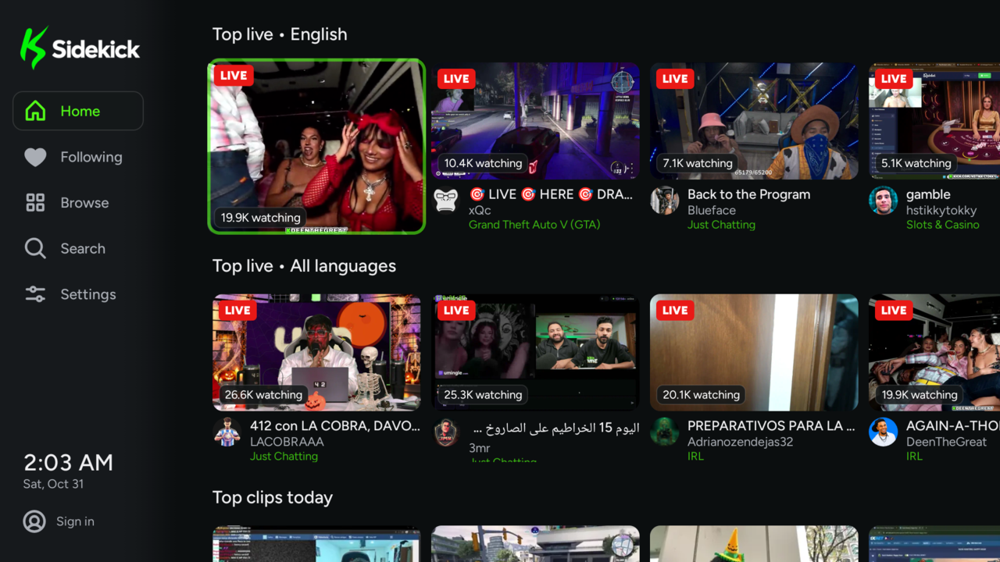

<p align="center">
  
</p>

<p align="center">
  <b>A free, open-source Kick app for Android TV, Google TV and Fire TV.</b><br>
  Live streams with chat, past broadcasts, clips, multi-view and more, built for the remote.
</p>

<p align="center">
  <a href="https://github.com/DIRIKtv/sidekick/releases/latest"></a>
  
  <a href="LICENSE"></a>
</p>

> **Unofficial.** Sidekick is not made, endorsed or supported by Kick. "Kick" is a trademark of its
> owner. See [Disclaimer](#disclaimer).

<p align="center">
  
  
  
  
</p>

<details>
<summary>More screenshots</summary>
<p align="center">
  
  
  
  
  
  
  
  
</p>
</details>

##  Features

###  Watching
- **Player:** rewind live streams back to the start, quality and speed, rolling TV-style captions,
  sleep timer, loudness equalization and picture-in-picture
- **Multi-view:** watch up to 4 live channels at once; the highlighted one plays sound
- **Past broadcasts:** resume or start over, seek previews while you scrub, and the original chat
  replayed in time with the video
- **Live previews:** rest on a stream and it starts playing, muted, right in the card or Home banner
- **Up next:** when a stream ends, Sidekick suggests what to watch next, and can follow raids

###  Chat
- **Your layout:** beside or over the video, anywhere on screen at any size, with its own text size
  and see-through backing. Each channel remembers its own layout
- **Everything Kick shows:** 7TV emotes, badges, pinned messages, polls and predictions with live results
- **Calmer chat:** hide bots and !commands, calm busy chats, add timestamps
- **Chat from your phone:** scan a QR code to read and send messages from your phone

###  Finding something to watch
- **Home:** live channels you follow, Continue watching, Recently watched, top streams in your
  language, today's top clips and popular categories
- **Search** with an on-screen keyboard (or your voice), split into live streams, categories and channels
- **Browse** categories, and hide the ones you never want to see (like Slots & Casino)
- **Channel pages** with past broadcasts and clips

###  Following
- **Your Kick follows,** plus favorites saved on the TV, with go-live alerts and a live count
- **Sign in** by scanning a QR code with your phone

###  Made for the TV
- **Built for the remote,** light enough for smaller Fire TV sticks
- **TV home screen** (Android TV / Google TV): a "Live on Kick" row and Play Next for past broadcasts
- **Make it yours:** fonts, card size, start-up page and page transitions
- **Automatic updates** straight from this page

<a name="install"></a>

##  Install

**Download link (always the newest version):**

```
https://github.com/DIRIKtv/sidekick/releases/latest/download/Sidekick.apk
```

### Fire TV (no computer needed)
1. Install **Downloader** (by AFTVnews) from the Amazon Appstore.
2. Settings → My Fire TV → Developer Options → **Install unknown apps** → turn on for Downloader.
   (No Developer Options? Settings → My Fire TV → About → click your device name 7 times.)
3. Open Downloader, enter the download link above, then choose **Install** and **Open**.

### Google TV / Android TV
1. Settings → System → About → click **Android TV OS build** 7 times to enable developer mode.
2. Settings → Apps → Security & restrictions → **Unknown sources** → allow the app you'll install with
   (Downloader, a file manager, or *Send Files to TV*).
3. Download or send the APK to the TV and open it to install.

### From a computer
```sh
adb connect <tv-ip>:5555        # turn on network debugging on the TV first
adb install -r Sidekick.apk
```

### Updates
Sidekick checks this page for a new version each time it opens and offers to install it
(Settings → Automatic updates: every open, once a day, or off). The first time, Android asks you to
allow Sidekick to install apps. Your settings and sign-in are kept.

##  Using it

| Remote | Does |
| --- | --- |
| **OK** on a card | Watch |
| **☰** (or hold OK) on a card | Open the channel page |
| **◀ ▶** while watching | Seek (hold to go faster) |
| **▲ ▼** while watching | Show the controls |
| **☰** while watching | Player settings: quality, chat, multi-view, sleep timer… |
| **Home** while watching | Keep watching in a corner (picture-in-picture, where supported) |

##  Privacy

No ads, no analytics, no accounts of our own. Your Kick sign-in is stored encrypted on the TV and only
sent to Kick. Phone sign-in sends your login to the TV over your home network, so use it on a network
you trust. Full details: [PRIVACY.md](PRIVACY.md).

<a name="disclaimer"></a>

##  Disclaimer

Sidekick is an independent, unofficial project. It is not affiliated with, endorsed by or connected to
Kick or its owners. "Kick" and the Kick logo are trademarks of their respective owner.

Kick doesn't offer an official API for TV apps, so Sidekick uses the same public endpoints as the
kick.com website. Kick can change these at any time, which may break features until an update is
released. Streams, chat and other content belong to their creators and are shown as Kick serves them.

##  Contributing

Bug reports and ideas are welcome, so please [open an issue](https://github.com/DIRIKtv/sidekick/issues/new/choose).
Pull requests are welcome too; for anything large, open an issue first so we can talk it through.

### Building

Requirements: JDK 21, Android SDK 36.

```sh
./gradlew assembleDebug        # debug build (installs alongside as com.diriktv.sidekick.debug)
./gradlew testDebugUnitTest    # unit tests
./gradlew lintRelease          # release lint (must be error-free)
```

<details>
<summary>Releasing (maintainer)</summary>

Release builds are signed with `keystore/sidekick-release.jks`, configured by `keystore.properties`
(both git-ignored; keep backups — without them, future versions can't install as updates). Without
`keystore.properties`, release builds fall back to the debug key.

1. Bump `appVersionName` and `appVersionCode` at the top of `app/build.gradle.kts`, add the changes
   to [CHANGELOG.md](CHANGELOG.md), and commit.
2. `scripts/release.sh` lints, builds the signed APK, tags and publishes the GitHub release, with
   notes built from that CHANGELOG.md section. Installed apps offer it the next time they're opened.
</details>

##  License

[MIT](LICENSE) © DIRIKtv

Icons from [Phosphor Icons](https://phosphoricons.com) — MIT © 2023 Phosphor Icons.
Fonts: [Figtree](https://github.com/erikdkennedy/figtree), [Inter](https://rsms.me/inter/) and [Manrope](https://github.com/googlefonts/manrope) — SIL Open Font License 1.1 ([licenses](docs/licenses)).
